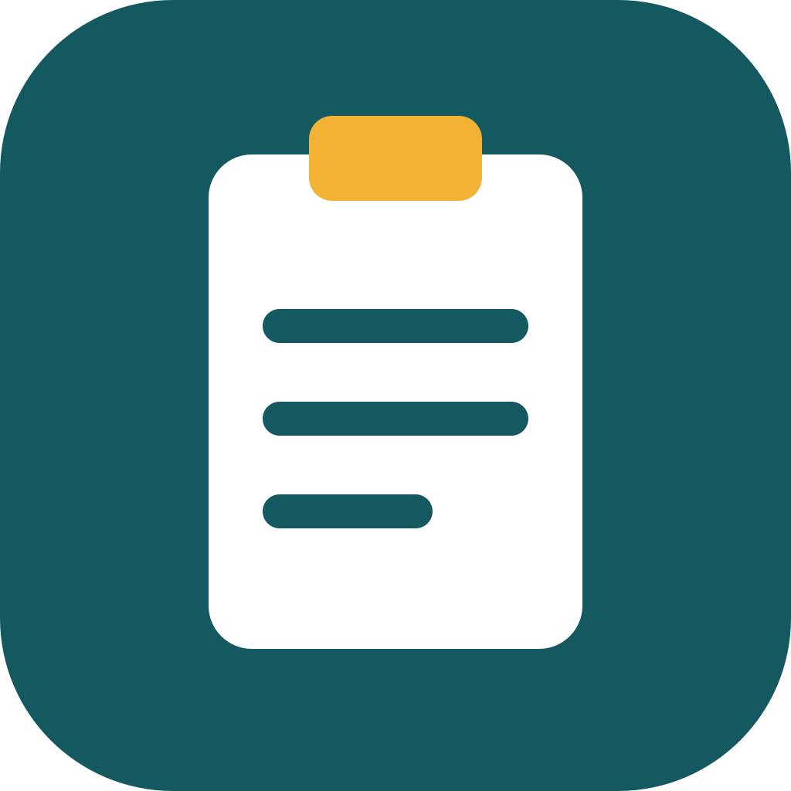

<p align="center">
  
</p>

<h1 align="center">WhatClip</h1>

<p align="center"><b>The clipboard history for macOS that keeps your copies private.</b><br>
Everything you copy, searchable and one shortcut away. Stays on your Mac. No account. No network.</p>

<p align="center">
  <a href="#install"></a>
  <a href="LICENSE"></a>
  
  
</p>

---

## Why WhatClip

macOS forgets whatever you copied before. WhatClip remembers it, so you can get back the link, the snippet or the image you copied an hour ago, without digging through old windows.

- **Press ⇧⌘X** and the picker opens under the menu-bar icon. Type to search, press Return to paste.
- **Private by design.** Copies from password managers and Keychain Access are never recorded. Copied API keys, tokens and card numbers are hidden and removed after a timer.
- **Everything is yours.** The history lives in your user folder, with optional encryption. Nothing is uploaded.

## Features

**Capture**
- Text, links, rich text, HTML, images, animated GIFs and copied files, restored in their original form
- Duplicates are merged, not repeated
- Ignore rules by app, pasteboard type or regular expression (for example, one-time codes)

**Find and reuse**
- Picker with search (fuzzy or exact), filters for type, pinned, favourites, time and app
- Keyboard first: arrows, Return, Shift-Return for plain text, ⌘1–9 to choose
- Cards view with thumbnails and colour swatches
- Stack: copy several things in order, then paste them one by one
- Snippets with `{{variables}}` filled in before you paste

**Organise**
- Pin, favourite (the Library), tag, and group into coloured boards
- Text tools: case, lines, JSON, Base64, URL encoding, word counts
- Smart actions for emails, phone numbers, dates, colours and file paths
- Text inside images is read on your Mac and is searchable

**Make**
- Screenshot of an area, a 5-second GIF of the screen, and an annotation editor (pen, line, rectangle, arrow)
- Export and import your history as a JSON file

**Desktop app**
- A main window with History, Library, Snippets, Settings and About
- Standard menus, Dock icon (optional), Dock menu, window memory
- Optional Touch ID or password lock before the history opens
- Save any text or file from any app with **Save to WhatClip** in the Services menu

## Install

You need a Mac with macOS 14 or later and the Command Line Tools (`xcode-select --install`). Xcode is not needed.

```sh
git clone https://github.com/moushaban-cell/whatclip.git && cd whatclip && ./scripts/install.sh
```

That runs the tests, builds the app and installs it to `/Applications/WhatClip.app`.

Or download the latest `WhatClip-*.zip` from the [Releases](../../releases) page, unzip it and drag it to Applications. The first time you open it, macOS may ask you to confirm, because the app is not notarised. Open it from Finder with right-click ▸ Open.

## Permissions

WhatClip works with no permission. Two are optional:

| Permission | Used for |
|---|---|
| Accessibility | pressing ⌘V for you after you choose an item |
| Screen Recording | screenshots and GIF recording |

See [docs/PERMISSIONS.md](docs/PERMISSIONS.md). Nothing outside WhatClip's own folder is changed.

## Privacy

WhatClip makes no network requests, has no account and collects no telemetry. Your history is stored in `~/Library/Application Support/WhatClip` with private file permissions. Details in [docs/PRIVACY.md](docs/PRIVACY.md).

## Keyboard

| Shortcut | Action |
|---|---|
| ⇧⌘X | Open the picker (you can change it in Settings) |
| Return / ⇧Return | Paste / paste as plain text |
| ⌘1–9 | Choose a visible item |
| ⌘P / ⌘D | Pin / favourite |
| ⌘E / ⌘Y | Extract text / Quick Look |
| ⌘⌫ | Delete |
| Esc | Close the picker or a window |
| ⌘, | Settings |

## Build and test

```sh
./scripts/test.sh          # 64 tests
./scripts/build-app.sh     # builds build/WhatClip.app
./scripts/package.sh       # builds dist/WhatClip-<version>.zip for a release
```

Set `WHATCLIP_SIGN_ID` to the name of your local code-signing certificate to keep permissions across rebuilds. Without one, the app is ad-hoc signed.

## Status and limits

- Secret detection works on the shape of text. It can miss unusual secrets and flag harmless text.
- Some apps never expose their copies to any clipboard tool.
- Screen recording, Touch ID and the Services entry are built but still being checked on more Macs.
- English only. Not notarised yet.

## Contributing

Issues and pull requests are welcome. Read [CONTRIBUTING.md](CONTRIBUTING.md) and [CODE_OF_CONDUCT.md](CODE_OF_CONDUCT.md). Report security problems privately as described in [SECURITY.md](SECURITY.md).

## Licence and credits

MIT licence, see [LICENSE](LICENSE). WhatClip was built after reading how other MIT clipboard managers work, including Maccy, Clipy, Flycut, FlowClip, pesty, ClipHistory, open-paste, Kelsiito/clipboard and clipflow. No code was copied from them. Third-party notices are in [THIRD_PARTY_NOTICES.md](THIRD_PARTY_NOTICES.md).
